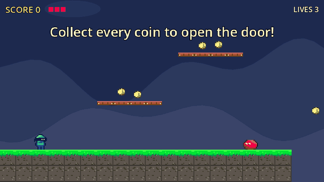
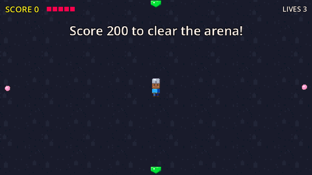

# Spawn Point

**Compile a small JSON "game graph" into a juicy, runnable Godot 4 game — in seconds.**

<p align="center">
  
  
</p>
<p align="center"><sub>Both games are built from <code>examples/pixel_hopper.json</code> and
<code>examples/pixel_arena.json</code>: generated sprites, collision traced from pixels, juice on by
default. Recorded with <code>spawnpoint gif</code> (autopilot).</sub></p>

Spawn Point is the foundation of an autonomous game-studio agent. Instead of asking an LLM to type
hundreds of lines of GDScript (slow, expensive, and easy to break with Godot 3/4 mix-ups), the LLM
assembles **pre-tested components** like LEGO, places them on an **ASCII map**, and wires gameplay
with **declarative rules**. A deterministic compiler validates everything and lets Godot itself write
the scenes.

```
graph.json ──► validate (Python) ──► build scenes (Godot headless) ──► smoke-run ──► playable project
               ~1 ms, LLM-friendly       ~2 s                            ~0.3 s
               error messages
```

| | Typical LLM-writes-code agents | Spawn Point |
|---|---|---|
| How code is produced | GDScript generated from scratch | Components + JSON graph |
| Time to a playable build | minutes to hours | ~3 seconds |
| Game feel | none by default | coyote time, jump buffer, squash & stretch, hit-stop, screen shake, particles, SFX — on by default |
| Hitboxes | drift from visuals | derived from the same shape as the visual |
| Failure mode | crashes, syntax errors | structured diagnostics *before* Godot runs |

## Spawn Point Studio (web cockpit)

```bash
spawnpoint studio          # opens http://localhost:8070 — games live in ./out
```

A local "studio floor" around the running game — no terminal needed:

- **Projects**: every game in the workspace; **New game** from a prompt (optionally with the
  playtester and the creative pass). Progress streams live while the layers land.
- **Arcade**: the web build in the middle, reloading by itself after every change.
  **Right-click an enemy or item in the game** to select it, then just say what to change:
  *"double its health and make it shoot fireballs"* — the LLM returns a patch scoped to that entity,
  the compiler checks it (with repair rounds), missing projectiles are created, and the game reloads.
- **Designer**: the brief, rules, tweak history, studio edits and tuning.
  **Artist**: every sprite sheet. **Developer**: every entity → component → parameter as a typed
  input with the manifest's ranges; editing one rebuilds the game (no LLM needed).
  **QA**: run the playtester or run + tune, with the stats table and the death heatmap.

Edits are stored as overrides in `studio.json` and survive later tweaks; they win over the tuner.
Standard library only on the server, one HTML/JS page on the client, Server-Sent Events for progress.

## Make a game from a sentence

```bash
scripts/llm-up.sh                     # SpawnPoint-Coder-7B on vLLM (~11 GB VRAM) — or any OpenAI-compatible API
spawnpoint create "a ninja platformer where you collect stars"
```

```
Design:
  “Ninja Star Dash” — platformer, palette candy, goal collect_all, short, difficulty 2
  player: double_jump, stomp; jump 4.0 tiles; speed fast; feel floaty; juice subtle
  enemies: 4x Goblin (walker), 2x Spider (hopper); pickups: 10x Star; hazards: spikes
  [L0 core loop] ok in 5.5s (build 3.1s, web 2.4s)
  ▶ playing at http://localhost:8060/  (the page reloads as layers land)
  [L1 goals & enemies] ok in 5.1s
  [L2 feel & polish] ok in 5.1s
Done in 25.7s (design 10.0s; LLM 2 call(s), 977 prompt + 256 completion tokens).
```

The browser opens on the first playable layer and reloads as the next ones land. Then iterate:

```bash
spawnpoint tweak out/ninja-star-dash "jump 20% higher and add a dash, night colors"
#   palette: "candy" -> "night"
#   player.abilities: ["double_jump", "stomp"] -> ["double_jump", "stomp", "dash"]
#   player.jump_tiles: 4.0 -> 4.8
```

Only what you asked for changes, and the level layout is kept. Prompts can be in any language
(non-English prompts are translated first). How it works:

1. **Design** — the LLM fills a small, enumerated **GameBrief** (genre, palette, abilities, enemy
   archetypes, pickups, goal, feel…) using guided JSON decoding, so even a 7B model cannot produce
   malformed output. A normalizer repairs typical small-model mistakes (plural names, archetypes that
   don't exist in the genre, impossible goals).
2. **Assemble** — deterministic: archetypes become tuned component bundles, goals become rules,
   levels are generated (platformer chunks tagged with the jump they need; top-down arenas whose
   floor is always connected) and re-seeded until the compiler finds everything reachable.
3. **Layers** — L0 core movement → L1 enemies, pickups, goal → L2 feel & juice; each one is compiled,
   exported to the web and live-reloaded.
4. **Creative pass** (`--creative`) — the LLM proposes a small graph patch (parameters, rules); the
   compiler's diagnostics drive up to two repair rounds; if it still fails, it is dropped.

**The model.** [SpawnPoint-Coder-7B](https://huggingface.co/smoky1496/SpawnPoint-Coder-7B-AWQ) is fine-tuned
for exactly these tasks and runs on a single 12 GB GPU (AWQ 4-bit). Exact-match on held-out Spawn Point
tasks versus the model it was tuned from: tweaks 62% → 97%, entity edits 47% → 100%, translation
9% → 91%, briefs needing repair by the normalizer 36% → 5%. `scripts/llm-up.sh` downloads and serves it.

LLM settings: `SPAWNPOINT_LLM_BASE_URL` (default `http://localhost:8000/v1`),
`SPAWNPOINT_LLM_MODEL` (default: the server's first model), `SPAWNPOINT_LLM_API_KEY`.
Web builds need the Godot **web export templates** (Editor → Manage Export Templates, or unpack
`web_*.zip` from the official `.tpz` into `~/.local/share/godot/export_templates/<version>/`);
use `--no-web` to skip and play natively with `spawnpoint run`.

## Sprites: generated or your own

Layer 2 replaces placeholder shapes with **procedural pixel-art sprites** — no assets, no GPU. The
kind follows the entity (`Goblin` → humanoid, `FireBat` → flyer, `LaserBot` → robot, `Crystal` → gem…)
and details follow the name (`Ninja` → mask, `Fox` → ears and tail, `Spider` → legs). Every sprite has
idle / run / jump / fall / hurt animations driven automatically by an `Animator` component.

**Collision comes from the pixels.** Hitboxes, hurtboxes, pickups, hazards and static bodies use the
sprite's traced outline (`CollisionPolygon2D`); moving bodies keep a smooth capsule/circle fitted to
the sprite's opaque bounds, so characters never snag on tile seams.

```bash
spawnpoint sprites kinds                                          # hero, slime, hopper, flyer, robot, ...
spawnpoint sprites generate hero --name Knight --color "#c2c3c7"  # assets/sprites/Knight.sprite.json
spawnpoint sprites import hero.png --grid 32x32 --anim idle=0-3 --anim run=4-9
spawnpoint sprites import sheet.png --rows idle,run,jump           # auto-sliced by transparent gutters
spawnpoint sprites import kenney_frames/                           # idle_0.png, walk_1.png, ...
spawnpoint sprites preview assets/sprites/Knight.sprite.json       # contact sheet + collision outline
```

Record a clip of any built game to share it (a window opens for a few seconds; autopilot plays):

```bash
spawnpoint gif out/pixel-hopper -o demo.gif --seconds 8 --fps 20 --width 640
```

Use one in a graph with `"sprite": "assets/sprites/Knight.sprite.json"` (relative to the graph file)
or `"sprite": {"generate": {"kind": "slime", "color": "#ff004d"}}` — see `examples/pixel_hopper.json`.
When an entity has a sprite and no explicit `shape`, its collision size comes from the drawing.

## Playtesting: bots find what's unfair, then fix it

```bash
spawnpoint playtest out/pixel-hopper --tune
```

```
  before:
    novice   won 1/3  deaths 5   (Spikes 4, Frog 1)  missed jumps 3/100  pickups 69%
    average  won 1/3  deaths 2   (Spikes 2)          missed jumps 3/92   pickups 92%
    expert   won 3/3  deaths 3   (fall 3)            missed jumps 0/43   pickups 100%
  round 1 (kept, score 0.8083 -> 0.475):
    Player.Hurtbox.size_scale = 0.75 — Spikes caused 6/7 deaths
    Player.Health.max_health = 4 — novice bots won only 1/3
  after:
    average  won 2/3  deaths 2   (Spikes 1, Slime 1)
```

Three bot skill levels (novice: slow reactions and late jumps; average; expert) press the same keys
a person would, so coyote time, jump buffering and knockback are tested for real. They navigate with
a jump-aware path planner over the tile map, so a failure means the level is hard — not that the bot
is lost. Runs are headless and seeded: 9 runs of up to a minute each take a few seconds.

- **Telemetry**: deaths with cause (`fall`, `Spikes`, `Slime`, `EnemyBullet`…) and position, missed
  jumps (pressed after coyote time ran out), stuck spots, pickups, targets the bots gave up on.
- **Report**: `playtest/report.md`, `report.json` and `heatmap.png` (deaths colored by cause).
- **Tuning** (`--tune`): bounded rules (late jumps → more coyote time; one enemy dominates → it slows
  down; spikes dominate → a more forgiving hurtbox; still too hard → more health…), targets set by the
  game's difficulty. Each round is rebuilt and re-tested and kept only if it gets closer to the targets.
  Studio games store the result in `studio.json`, so later tweaks keep it;
  `spawnpoint create "..." --playtest` does all of this automatically after layer 2.

### Collecting fine-tuning data (opt-in, local only)

```bash
spawnpoint create "..." --record        # or export SPAWNPOINT_RECORD=1 for every create/tweak
spawnpoint dataset stats                # records per task, accepted, corrected by the pipeline
```

Each LLM call is appended to `~/.local/share/spawnpoint/dataset/<date>.jsonl` (override with
`SPAWNPOINT_DATASET_DIR`) with the exact `messages`, the model's `raw` answer, and the `target` the
pipeline actually used — the normalized brief, or the patch the compiler accepted — plus `notes`,
compiler `errors`, `accepted` and `corrected`. Training on `messages → target` teaches the model to
stop making the mistakes the normalizer and compiler had to fix (roadmap item 7). Nothing is uploaded.

## Quick start (hand-written graphs)

Requirements: Python ≥ 3.10 and [Godot 4.6](https://godotengine.org/download) on your `PATH`
(`godot4` or `godot`, or set `GODOT_BIN`).

```bash
pip install -e ".[dev]"
spawnpoint build examples/coin_hopper.json --run     # platformer
spawnpoint build examples/neon_arena.json --run      # top-down shooter
```

Controls: move **WASD / arrows**, jump **Space / Z / W**, dash **Shift / C**, shoot **X / J / left mouse**,
restart **R**.

The output in `out/<game>/` is a normal Godot project. Open `project.godot` in the editor and keep
developing; the component library is copied into `addons/spawn_point/`.

## A game graph

```json
{
  "name": "Coin Hopper",
  "genre": "platformer",
  "entities": {
    "Player": {
      "shape": { "type": "capsule", "size": [22, 34] },
      "components": { "PlatformerMovement": { "air_jumps": 1 }, "PlayerInput": {},
                      "Health": { "max_health": 3 }, "Hurtbox": {}, "Stomp": {} }
    },
    "Slime": {
      "components": { "PlatformerMovement": { "max_speed": 60 }, "PatrolAI": {},
                      "Health": { "max_health": 1 }, "Hurtbox": {}, "Hitbox": {} }
    },
    "Coin": { "body": "area", "shape": { "type": "circle", "size": [14, 14] },
              "components": { "Collectible": { "score": 1 } } },
    "Exit": { "body": "area", "components": { "TriggerZone": {} } }
  },
  "level": {
    "map": ["...........C......",
            "......=====.......",
            ".P.......C....S..E",
            "##################"],
    "legend": { "#": "solid", "=": "oneway", "P": "Player", "S": "Slime", "C": "Coin", "E": "Exit" }
  },
  "rules": [
    { "on": "Exit.triggered", "if": "count('Coin') == 0", "do": ["win()"] },
    { "on": "Slime.died", "do": ["add_score(5)"] }
  ]
}
```

- **Entities** are a body (`character` / `static` / `area`), a placeholder `shape`
  (`rect`, `circle`, `capsule`, `triangle`, `spikes`, `none`) and components with parameters.
  Colors default from the entity's role; collision shapes always match the visual.
- **Level** is an ASCII map. `solid` and `oneway` are tiles; any other legend value is an entity.
- **Rules**: `on` an event (`Entity.signal`, `Entity.Component.signal`, `GameState.score_changed`,
  `Game.ready`…), optional `if` expression, `do` actions (`win()`, `add_score(n)`, `Door.open()`,
  `spawn("Slime")`, `shake(0.5)`, `message("Hi")`…). They compile to a readable `rules.gd`.

See the full reference in the [design spec](docs/superpowers/specs/2026-10-07-component-library-and-graph-compiler-design.md),
and list every component with its parameters, signals and methods:

```bash
spawnpoint components          # human-readable
spawnpoint components --json   # the manifest an LLM can consume
```

## Diagnostics built for self-correction

```bash
$ spawnpoint validate broken.json
  ✗ error[E_UNKNOWN_PARAM] entities.Player.components.Health.max_hp: Health has no parameter 'max_hp' (hint: Did you mean 'max_health'?)
  ✗ error[E_RULE_DO] rules[0].do[1]: Door has no method 'opne' (hint: Did you mean 'open'?)
  ! warning[W_UNREACHABLE] level.map: Coin at (44,2) looks unreachable (jump ≈ 3 tiles up, 4 across)
```

`--json` prints the same as `{severity, code, path, message, hint}` objects. Builds also run a
headless smoke test (spawn, scripted input, crash detection) and report `E_RUNTIME` errors.

## Components

| Category | Components |
|---|---|
| Movement | `PlatformerMovement` (coyote time, jump buffer, variable jump, apex hang, dash, double jump), `TopDownMovement` (accel/friction, dash) |
| Controllers | `PlayerInput`, `PatrolAI`, `ChaseAI`, `Aim` |
| Combat | `Health`, `Hitbox`, `Hurtbox`, `Stomp`, `Weapon`, `Projectile` |
| World | `Collectible`, `TriggerZone`, `Spawner`, `Gate` |
| Feel | `Juice` — attached to every entity unless `"juice": "none"` |

Runtime autoloads: `GameState` (score, lives, variables, win/lose), `World` (spawning, rule
bindings), `FX` (hit-stop, shake, particles, floating text), `Sfx` (pooled sounds with pitch
variation). Sounds are synthesized at build time by a built-in sfxr port — no assets needed.

## Repository layout

```
godot/                     Godot project hosting the component library and its tests
  addons/spawn_point/      components/, runtime/, tools/ (build, smoke, capture), manifest.json
  tests/                   headless GDScript tests
compiler/spawnpoint/       Python compiler: graph schema, analysis, rules codegen, sfx, CLI
compiler/spawnpoint/studio LLM orchestrator: brief, assembler, level generators, web export, browser check
compiler/spawnpoint/sprites SpriteSet format, pixel-art generator, importer, contour → collision
compiler/tests/            pytest (includes end-to-end builds and the GDScript suite)
examples/                  example graphs
docs/                      design specs
```

## Development

```bash
pytest                      # everything: compiler, studio, end-to-end builds, web + browser, GDScript suite
pytest -m "not llm"         # without the live-LLM tests
spawnpoint manifest         # regenerate manifest.json after changing a component
godot4 --headless --path godot --fixed-fps 60 res://tests/run_tests.tscn   # GDScript suite only
```

Adding a component: create `godot/addons/spawn_point/components/<name>_component.gd` following the
contract (typed `@export`s with ranges, `SP_NAME` / `SP_HOSTS` / `SP_REQUIRES` / `SP_CATEGORY`
constants, `##` docs on everything public), add tests in `godot/tests/`, then run `spawnpoint manifest`.

## Roadmap

1. ✅ Component library with juice
2. ✅ Graph compiler (validation, rules, levels, SFX, smoke test)
3. ✅ Studio orchestrator — prompt → brief → layered builds, web export with live reload, tweaks, creative pass
4. ✅ Asset pipeline — procedural pixel-art sprites, sheet/folder import with auto-slicing, outline → `CollisionPolygon2D`, automatic animation (AI image generation later, as a plug-in provider)
5. ✅ Playtester — skill-profiled bots with a jump-aware planner, telemetry, death heatmaps, bounded auto-tuning
6. ✅ Web cockpit — `spawnpoint studio`: live arcade, right-click-to-edit with the LLM, parameter desk, sprite gallery, playtest desk
7. ✅ **[SpawnPoint-Coder-7B](https://huggingface.co/smoky1496/SpawnPoint-Coder-7B-AWQ)** — a fine-tuned 7B model (QLoRA, trainable and servable on a
   single 12 GB consumer GPU such as an RTX 3060) specialised in briefs, tweaks and graph patches, so
   the whole studio runs well offline for free. The compiler acts as the data filter and the judge:
   every training example must compile, and evaluation measures first-try validity, how often the
   normalizer has to repair output, and whether tweaks change only what was asked.
   Hosted providers (Claude, OpenAI, any OpenAI-compatible API) stay supported via `SPAWNPOINT_LLM_*`.

## License

MIT
